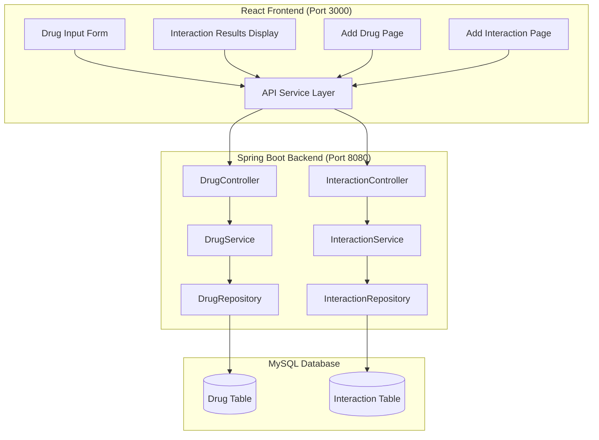

# Drug Interaction & Prescription Safety System - Architecture

## System Overview
A full-stack web application for checking drug interactions with severity levels and warnings.

## Architecture Diagram



## Project Structure

### Backend (Spring Boot)
```
backend/
├── src/
│   └── main/
│       ├── java/
│       │   └── com/
│       │       └── druginteraction/
│       │           └── system/
│       │               ├── controller/
│       │               │   ├── DrugController.java
│       │               │   └── InteractionController.java
│       │               ├── service/
│       │               │   ├── DrugService.java
│       │               │   └── InteractionService.java
│       │               ├── repository/
│       │               │   ├── DrugRepository.java
│       │               │   └── InteractionRepository.java
│       │               ├── entity/
│       │               │   ├── Drug.java
│       │               │   ├── Interaction.java
│       │               │   └── Severity.java
│       │               ├── dto/
│       │               │   ├── DrugRequest.java
│       │               │   ├── DrugResponse.java
│       │               │   ├── InteractionRequest.java
│       │               │   ├── InteractionResponse.java
│       │               │   └── CheckInteractionRequest.java
│       │               └── DrugInteractionSystemApplication.java
│       └── resources/
│           ├── application.properties
│           └── data.sql
├── pom.xml
└── mvnw
```

### Frontend (React)
```
frontend/
├── public/
│   └── index.html
├── src/
│   ├── components/
│   │   ├── DrugInput.jsx
│   │   ├── InteractionResult.jsx
│   │   └── Navbar.jsx
│   ├── pages/
│   │   ├── HomePage.jsx
│   │   ├── AddDrugPage.jsx
│   │   └── AddInteractionPage.jsx
│   ├── services/
│   │   └── api.js
│   ├── App.jsx
│   ├── index.js
│   └── styles.css
├── package.json
└── README.md
```

## API Endpoints

### Drug APIs
| Method | Endpoint | Description |
|--------|----------|-------------|
| GET | /api/drugs | Get all drugs |
| POST | /api/drugs | Add new drug |
| GET | /api/drugs/{id} | Get drug by ID |

### Interaction APIs
| Method | Endpoint | Description |
|--------|----------|-------------|
| GET | /api/interactions | Get all interactions |
| POST | /api/interactions | Add new interaction |
| POST | /api/check | Check interactions for drug list |

## Database Schema

### Drug Table
```sql
CREATE TABLE drug (
    id BIGINT PRIMARY KEY AUTO_INCREMENT,
    name VARCHAR(255) UNIQUE NOT NULL,
    description VARCHAR(1000)
);
```

### Interaction Table
```sql
CREATE TABLE interaction (
    id BIGINT PRIMARY KEY AUTO_INCREMENT,
    drug1_id BIGINT NOT NULL,
    drug2_id BIGINT NOT NULL,
    severity VARCHAR(10) NOT NULL,
    description VARCHAR(1000),
    FOREIGN KEY (drug1_id) REFERENCES drug(id),
    FOREIGN KEY (drug2_id) REFERENCES drug(id)
);
```

## Severity Levels (Color Coding)
- **LOW** - Green - Minor interaction, monitor
- **MEDIUM** - Yellow/Orange - Moderate interaction, caution advised
- **HIGH** - Red - Severe interaction, avoid combination

## Technologies Used

### Backend
- Java 17+
- Spring Boot 3.x
- Spring Data JPA
- MySQL 8.x
- Maven

### Frontend
- React 18
- Axios (HTTP client)
- React Router (navigation)
- CSS3 (styling)
